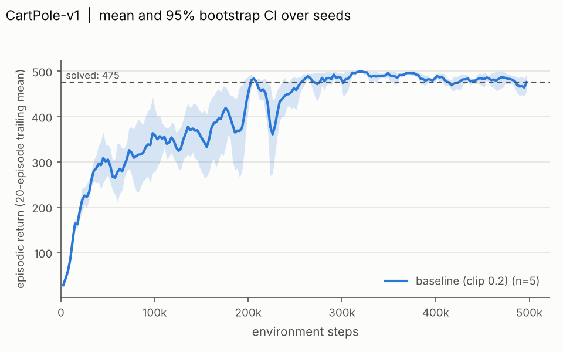
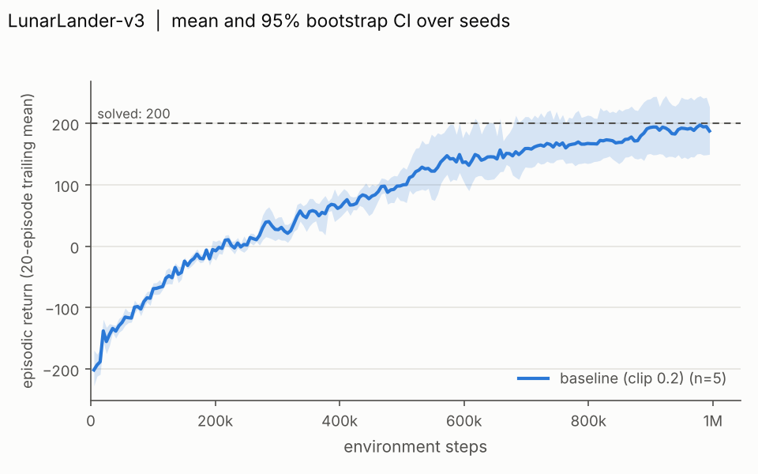
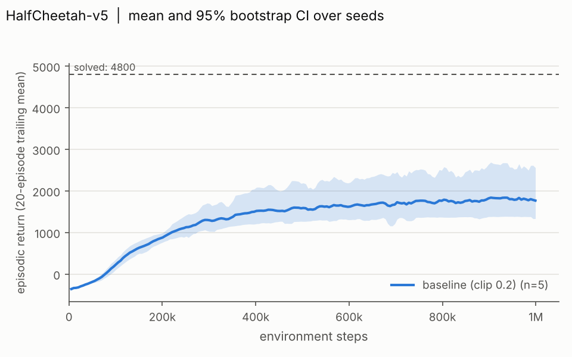
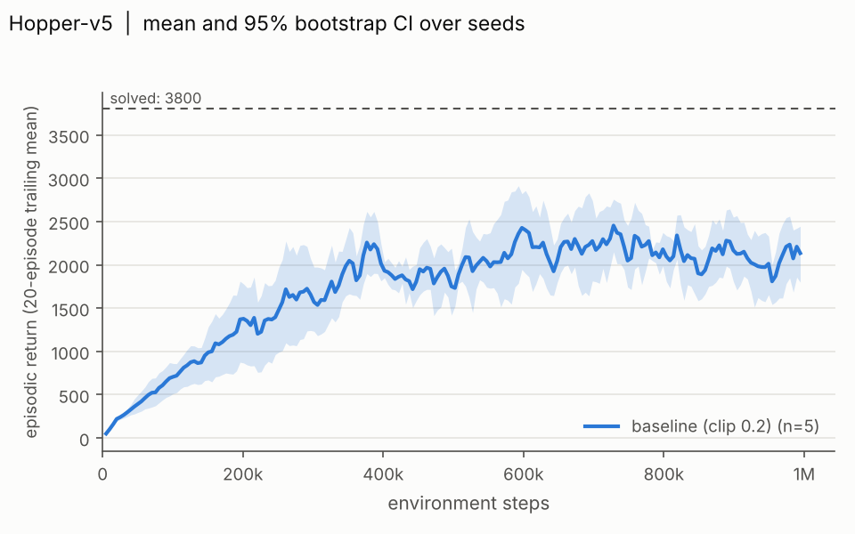
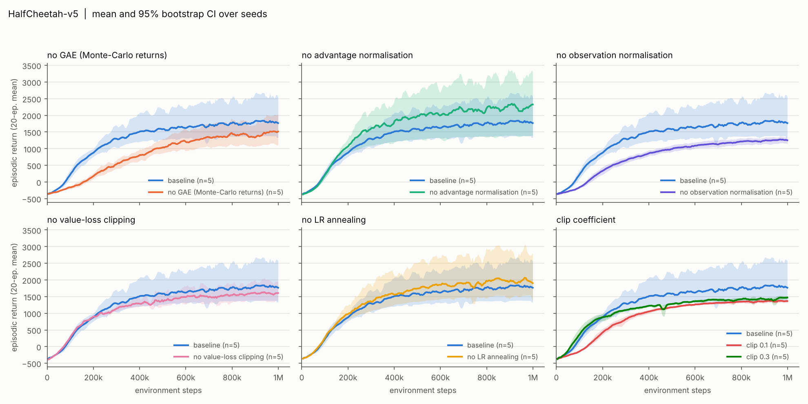
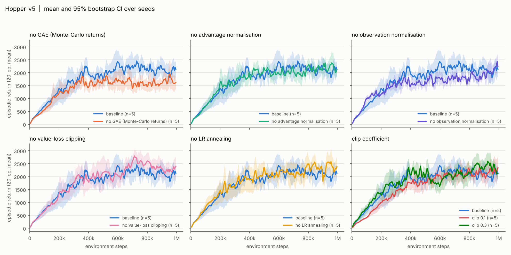

# PPO from scratch in PyTorch

A from-scratch implementation of Proximal Policy Optimization (PPO) in PyTorch. The only libraries
used are `torch` and `gymnasium` (environments); there is no RL library. The code is validated with
unit tests on the numerically sensitive parts, a CartPole sanity check, and a multi-seed study on
discrete and continuous-control environments, including an ablation of the implementation details
that are usually left out of PPO descriptions.

> **Status.** The implementation, the tests, the analysis pipeline and the full sweep (90 runs: four
> environments, five seeds each, plus seven ablations on HalfCheetah-v5 and Hopper-v5) are done. The
> numbers below come from `analysis/output/summary.md`, generated from the logs in `results/`. The one
> published reference quoted (CleanRL) could not be checked against its source page; see the note in
> the continuous-control section.

## What is implemented

| Component | File | Notes |
|---|---|---|
| Actor-critic | `ppo/agent.py` | separate tanh MLPs, orthogonal init (gain sqrt(2) hidden, 0.01 policy head, 1.0 value head), `Categorical` policy for discrete actions, diagonal `Normal` with a state-independent log-std for continuous actions |
| Rollout buffer | `ppo/buffer.py` | GAE(lambda) and a Monte-Carlo-return variant, `terminated`/`truncated` handled through the done flags, seeded shuffled minibatches |
| PPO update | `ppo/algo.py` | clipped surrogate, optional clipped value loss, per-minibatch advantage normalisation, entropy bonus, gradient-norm clipping, optional `target_kl` early stop; reports policy/value loss, entropy, approximate KL, clip fraction, explained variance |
| Environments | `ppo/envs.py` | seeded `SyncVectorEnv`, raw episode statistics, action clipping, running observation normalisation and reward scaling (both clipped to [-10, 10]) |
| Training loop | `ppo/train.py` | rollout, bootstrap, update, learning-rate annealing, seeding, CSV logging; every `Config` field is a command-line flag |
| Logging | `ppo/logger.py` | `progress.csv` (one row per finished episode) and `metrics.csv` (one row per update) per run |
| Experiments | `experiments/` | default YAML config per environment, ablation definitions, multi-process sweep runner |
| Analysis | `analysis/` | aggregation on a common step grid, bootstrap confidence intervals, learning-curve plots, ablation table |

The details that decide whether PPO works are the ones listed in *The 37 Implementation Details of
Proximal Policy Optimization* (Huang et al., 2022) and *Implementation Matters in Deep Policy
Gradients* (Engstrom et al., 2020); the ablations below test a subset of them.

## Install

```bash
python -m venv .venv
source .venv/bin/activate
pip install -r requirements.txt
```

`requirements.txt` pulls in `gymnasium[mujoco,box2d]`, which is needed for LunarLander, HalfCheetah and
Hopper. CartPole and Pendulum need neither extra. If the MuJoCo wheel does not install locally, the
same commands work on a Colab CPU runtime.

## Quick start

```bash
# train one agent
python -m ppo.train --env-id CartPole-v1 --seed 0 --run-name demo --total-timesteps 100000

# short end-to-end check: one CartPole run and two short HalfCheetah runs
bash scripts/smoke_test.sh

# unit tests
pytest -q
```

Logs are written to `results/<env_id>/<run_name>/seed_<n>/` (`config.json`, `progress.csv`,
`metrics.csv`). Run `python -m ppo.train --help` for all hyperparameters.

## Reproduce the study

```bash
python experiments/run_sweep.py --all --dry-run     # print the 90 commands
python experiments/run_sweep.py --all --jobs 4      # run them (long; finished runs are skipped on restart)
python analysis/plot_curves.py                      # figures + tables in analysis/output/
```

* **Main runs:** the default config of CartPole-v1, LunarLander-v3, HalfCheetah-v5 and Hopper-v5,
  seeds 0 to 4 (`experiments/configs/*.yaml`).
* **Ablations (HalfCheetah-v5 and Hopper-v5, seeds 0 to 4):** no GAE (Monte-Carlo returns), no advantage
  normalisation, no observation normalisation, no value-loss clipping, no learning-rate annealing, and
  clip coefficient 0.1 and 0.3 (0.2 is the baseline). Each ablation changes exactly one setting of the
  baseline config (`experiments/ablations.py`).
* To reduce the compute budget, use fewer seeds (`--seeds 0 1 2`) or fewer steps (`--max-steps`), and
  state that next to the results. Runs with a shortened budget are not comparable to the numbers below.

### How the analysis computes its numbers

* **Learning curve of one seed:** at step `s`, the mean return of the last 20 episodes that finished at or
  before `s` (the window is `--window`), linearly interpolated onto a grid of 200 steps. Grid points
  before a seed's first finished episode or after its last one are left empty rather than extrapolated.
* **Curve over seeds:** the mean over seeds with a 95% percentile-bootstrap confidence interval
  (10,000 resamples of the seeds), drawn only where every seed has data.
* **Final return:** per seed, the mean return of the last 10 training episodes; then the mean over seeds
  with a 95% bootstrap interval. The table also gives the difference to the baseline with its own
  bootstrap interval; a difference whose interval excludes zero is starred.
* Runs that did not reach 95% of their `total_timesteps` are excluded unless `--include-unfinished` is passed.

Outputs: `analysis/output/figures/<env>_baseline.png`, `<env>_ablations.png`, and `summary.md`,
`summary.csv`, `final_returns_per_seed.csv`, `curves.csv`.

## Results

All returns are training-episode returns of the stochastic policy in the unnormalised environment, so
they include exploration noise. "Final return" is the mean of the last 10 training episodes per seed;
the table shows the mean over five seeds (0 to 4) with a 95% percentile-bootstrap interval.

### Sanity and discrete control

| Environment | Steps | Solved threshold | Final return (mean, 95% CI over seeds) | Seeds |
|---|---|---|---|---|
| CartPole-v1 | 500k | 475 | 496.6 [489.8, 500.0] | 5 |
| LunarLander-v3 | 1M | 200 | 198.5 [159.9, 240.8] | 5 |




* **CartPole-v1:** the final return of the five seeds is 483, 500, 500, 500 and 500. The rolling mean of 100
  episodes passed 475 within the 500k steps on every seed, so the sanity threshold is met.
* **LunarLander-v3:** the threshold is reached on average only nominally. Per seed the final return is
  240.5, 159.1, 174.2, 150.4 and 268.2, so two of five seeds are above 200, and the interval over seeds
  contains 200. The config was tuned on seed 0 only, and seed 0 is part of these five, so its result is
  optimistic. The first config (8 environments x 128 steps, clipped value loss, annealed learning rate)
  stayed between 44 and 90 on all five seeds; the final config uses 16 x 1024 steps, minibatches of 64, no
  value-loss clipping and a constant learning rate (`experiments/configs/lunarlander.yaml`). That tuning
  history is not part of the logs in `results/`.

### Continuous control

| Environment | Steps | This implementation (mean, 95% CI) | Published PPO reference (unverified) | Seeds |
|---|---|---|---|---|
| HalfCheetah-v5 | 1M | 1,759.6 [1,294.9, 2,540.5] | CleanRL, HalfCheetah-v4: 1442.64 +/- 46.03 | 5 |
| Hopper-v5 | 1M | 2,109.7 [1,792.9, 2,445.3] | CleanRL, Hopper-v4: 2382.86 +/- 271.74 | 5 |

**About the reference column.** The CleanRL numbers were read from a search-result snippet of the CleanRL
PPO documentation (`ppo_continuous_action.py`); the documentation page itself could not be opened when
this was written. The 1M-step budget is inferred, not read from the page, and the reference uses the
`-v4` environments, not `-v5`. Treat the column as an order of magnitude check only, and verify it
against https://docs.cleanrl.dev/rl-algorithms/ppo/ before citing it. No Stable-Baselines3 number is
quoted because no source with a clear step budget and environment version was found.

The two environments agree with the reference to the same order of magnitude: HalfCheetah is above it and
Hopper below it, with different environment versions, hyperparameters and seeds, so a gap in either
direction proves nothing about a bug or an improvement. The HalfCheetah baseline is dominated by one
seed: the five final returns are 1,388, 1,439, 3,275, 1,527 and 1,169, with a median of 1,439.




### Ablations

Final return of every ablation next to the baseline, same five seeds, same budget (the source is
`analysis/output/summary.md`, which also has the intervals). A star marks a difference whose bootstrap
interval excludes zero.

| Config | HalfCheetah-v5 final return | Delta vs baseline | Hopper-v5 final return | Delta vs baseline |
|---|---|---|---|---|
| baseline | 1,759.6 | - | 2,109.7 | - |
| no GAE | 1,527.6 | -232.1 (-13%) | 1,491.5 | -618.2 (-29%) * |
| no advantage normalisation | 2,293.5 | +533.9 (+30%) | 1,996.8 | -112.8 (-5%) |
| no observation normalisation | 1,248.2 | -511.5 (-29%) * | 1,987.2 | -122.5 (-6%) |
| no value-loss clipping | 1,606.6 | -153.1 (-9%) | 2,231.8 | +122.1 (+6%) |
| no LR annealing | 1,811.6 | +51.9 (+3%) | 2,340.9 | +231.3 (+11%) |
| clip 0.1 | 1,378.8 | -380.8 (-22%) | 2,332.4 | +222.8 (+11%) |
| clip 0.3 | 1,471.3 | -288.3 (-16%) | 2,272.2 | +162.5 (+8%) |

Per-ablation learning curves against the baseline:




### Discussion

* **Only two of the 14 comparisons are starred:** no observation normalisation on HalfCheetah (-29%,
  interval [-1,284, -22], barely excluding zero) and no GAE on Hopper (-29%, interval [-1,003, -249]).
  There was no correction for making 14 comparisons, so roughly one false positive at the 95% level is
  expected by chance alone. Read these two as suggestive, in line with the usual view that GAE and
  observation normalisation matter, and not as established.
* **Everything else is within the seed-to-seed spread.** The largest apparent gain, no advantage
  normalisation on HalfCheetah (+30%), has an interval of [-671, +1,769]. It is driven by a wide spread
  of seeds, not by a reliable effect, and the same switch is slightly negative on Hopper.
* **Clip coefficient:** 0.1 and 0.3 are both below the baseline mean on HalfCheetah and both above it on
  Hopper, and no interval excludes zero. The data do not show a preferred value in 0.1 to 0.3. On
  HalfCheetah both clip variants have very tight intervals next to the broad baseline interval, which
  mostly reflects the one high baseline seed.
* **Learning speed:** without GAE the HalfCheetah curve rises clearly more slowly for most of training (see
  the figure) and ends 13% below the baseline at 1M steps. Without observation normalisation the curve
  is lower throughout, with a narrow band over seeds, which fits the starred final difference.
* **What this study cannot say:** five seeds, one hyperparameter setting per environment, and no
  re-tuning of the ablated runs. A component that looks unimportant here may matter under other
  settings, and a small effect would need many more seeds to detect.

## Tests

`pytest -q` runs the suite in `tests/` (it does not need MuJoCo or Box2D):

| File | Covers |
|---|---|
| `test_gae.py` | GAE and Monte-Carlo returns against hand-computed values, including a done flag in the middle of a rollout and a done at the bootstrap step; independence of environments; minibatch coverage and seeding |
| `test_algo.py` | clipped objective: zero gradient when the ratio is outside the clip range in the favourable direction, non-zero gradient otherwise (all four sign/ratio cases, discrete and continuous); clip fraction and KL; value loss; entropy bonus; gradient clipping; `target_kl`; a toy bandit and value-regression convergence check |
| `test_agent.py` | output shapes, near-uniform initial policy, unit-variance initial Gaussian, state-independent entropy, orthogonal initialisation with the expected gains, gradient flow |
| `test_envs.py` | environment specs, seeding determinism, observation normalisation against a running mean/std computed independently, reward normalisation without changing the reported episode returns, action clipping |
| `test_logger.py` | directory layout, CSV column names, row order, `config.json` round trip, `Config` helpers |
| `test_aggregate.py`, `test_plot_curves.py` | the analysis pipeline on small synthetic logs |

## Limitations

* **Five seeds are few.** A bootstrap interval over five seeds is itself noisy and tends to be too narrow;
  treat the starred differences in the ablation table as suggestive, not as significance tests, and
  prefer large effects over small ones. More seeds are cheap to add: `--seeds 5 6 7 8 9`.
* **Hyperparameters were not tuned per ablation.** Each ablation changes one setting of the baseline
  config only; an ablated component may need a different learning rate or clip range to work well.
* **Training returns, not evaluation returns.** Final returns are averaged over the last 10 training
  episodes of the stochastic policy. A separate deterministic evaluation could score higher.
* **Reference numbers** come from other codebases, other library versions and other seeds; a gap to them is
  a hint, not a proof of a bug or of a better implementation.
* **Truncation is treated as termination.** A time-limit truncation sets the done flag and the value is not
  bootstrapped from the final observation. HalfCheetah always truncates at 1000 steps, so its value targets
  are slightly biased near the end of each episode; Hopper is affected less because it mostly terminates.
* **Autoreset mode.** The environments use gymnasium's same-step autoreset, and observation normalisation is
  a small wrapper in `ppo/envs.py` because gymnasium's own wrapper rejects that mode.
* **LunarLander was tuned on one seed** that is also part of the reported five (see Results).
* **CPU only.** Runs use the CPU with a single torch thread each. Wall-clock times depend on the machine
  and are not reported here.
* **Scope.** Feed-forward policies, a single synchronous vector environment per run, no recurrent
  policies, no image observations, no multi-GPU or asynchronous collection.

## Repository layout

```
ppo/           config.py agent.py buffer.py algo.py envs.py logger.py train.py
experiments/   configs/*.yaml  ablations.py  run_sweep.py
analysis/      aggregate.py  plot_curves.py
tests/         test_gae.py test_algo.py test_agent.py test_envs.py test_logger.py
               test_aggregate.py test_plot_curves.py
scripts/       smoke_test.sh
results/       <env>/<run_name>/seed_<n>/{config.json,progress.csv,metrics.csv}   (logs of the sweep; model checkpoints are not tracked)
```

## References

* Schulman et al., *Proximal Policy Optimization Algorithms* (2017)
* Schulman et al., *High-Dimensional Continuous Control Using Generalized Advantage Estimation* (2015)
* Huang et al., *The 37 Implementation Details of Proximal Policy Optimization*, ICLR Blog Track (2022)
* Engstrom et al., *Implementation Matters in Deep Policy Gradients: A Case Study on PPO and TRPO* (2020)
* CleanRL `ppo.py` and `ppo_continuous_action.py`, used as a point of comparison for hyperparameters and results
